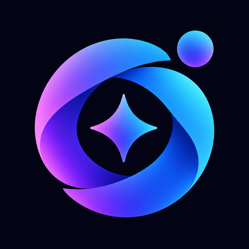
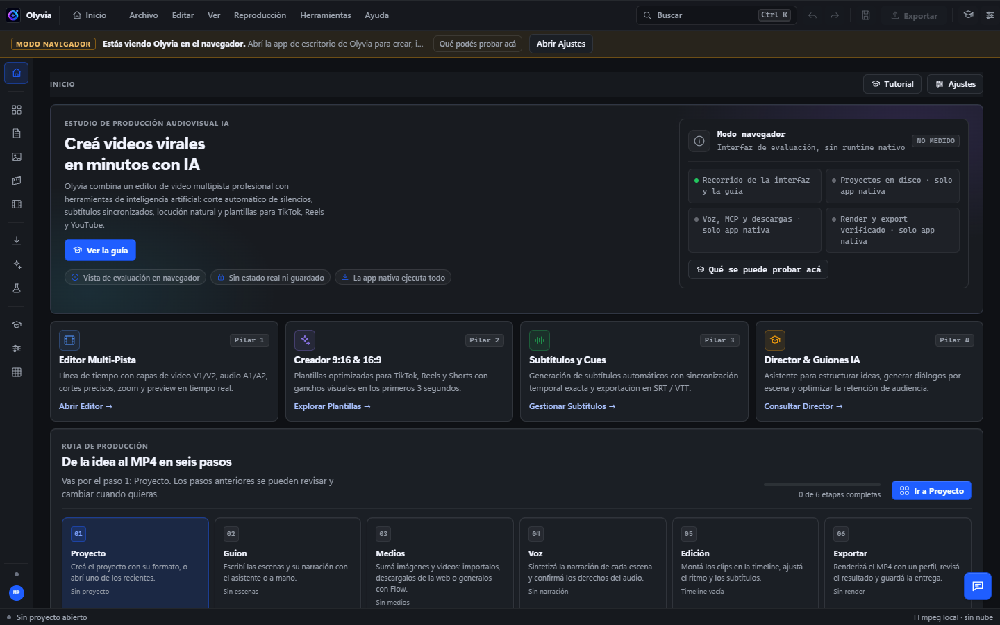
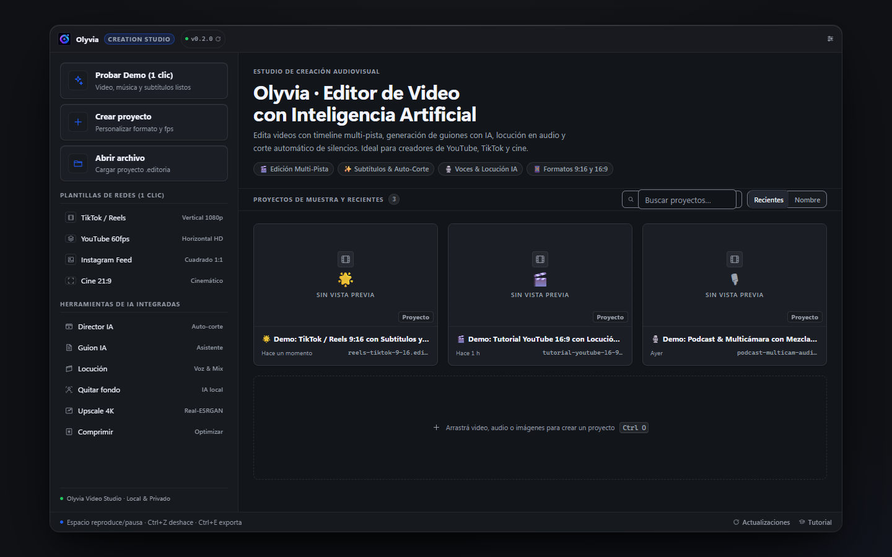
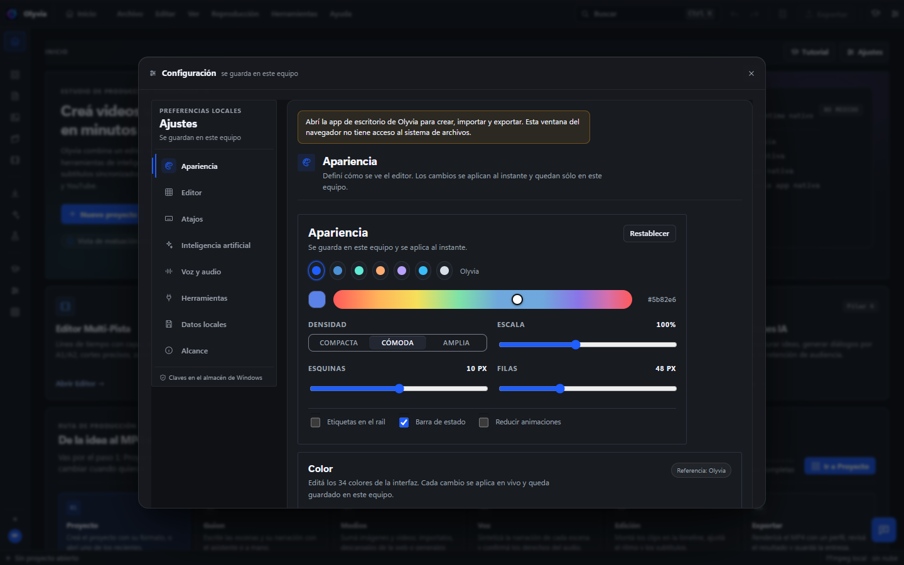
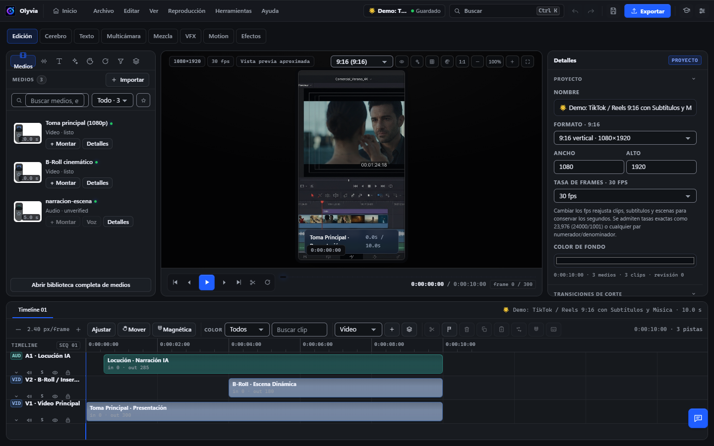

<div align="center">
  
  <h1>Olyvia</h1>
  <p><strong>Un estudio de creación y edición de vídeo para Windows.</strong></p>
  <p>
    Edición multipista, motion graphics, herramientas audiovisuales y automatización con IA opcional.
    Diseñado para trabajar localmente, con control sobre tus proyectos y tus medios.
  </p>
  <p>
    <a href="#capturas">Ver la aplicación</a> ·
    <a href="#funcionalidades">Funcionalidades</a> ·
    <a href="#instalacion">Instalación</a> ·
    <a href="docs/TUTORIAL.md">Tutorial</a>
  </p>
  <p>
    
    
    
    
    
  </p>
</div>

---

## Capturas

<p align="center">
  
</p>

<p align="center">
  
  
</p>

<p align="center">
  
</p>

## ¿Qué es Olyvia?

Olyvia es una aplicación de escritorio **local-first** para crear, editar y producir contenido audiovisual desde Windows. Reúne en un mismo entorno el flujo de trabajo de un editor de vídeo, herramientas de procesamiento multimedia y funciones de asistencia y automatización.

La IA es opcional: podés trabajar con herramientas locales y conectar proveedores o servicios externos cuando los necesites. No hace falta depender de una plataforma en la nube para organizar proyectos y editar material.

## Funcionalidades

| Área | Qué podés hacer |
| --- | --- |
| **Edición de vídeo** | Timeline multipista, recorte, composición, keyframes, velocidad, cámara lenta, transiciones, máscaras y efectos por clip. |
| **Color y acabado** | LUTs, scopes, ajustes de imagen, comparación antes/después, reducción de ruido y herramientas VFX. |
| **Apariencia** | Estudio de color con 34 tokens editables y 7 presets, contraste WCAG con «Corregir texto», exportar/importar tema `olyvia-theme`, densidad y radios ajustables; timeline con densidad cómoda/compacta, etiquetas de clip y rejilla alineada a la regla. |
| **Audio y voz** | Mezcla por pistas, paneo, EQ, ducking, medición de loudness, narración local y procesamiento de audio. |
| **Guion y producción** | Organización por escenas, generación asistida de guiones, asignación de medios y montaje automatizado. |
| **Subtítulos e idiomas** | Importación y exportación SRT/VTT/ASS, transcripción, traducción, doblaje y subtítulos animados. |
| **Contenido para redes** | Shorts, reencuadre vertical, formatos de exportación, miniaturas y comprobaciones previas por plataforma. |
| **Herramientas multimedia** | Conversión y compresión, procesamiento por lotes, upscale, eliminación de fondo y análisis de archivos. |
| **IA e integraciones** | Proveedores OpenAI-compatible, modelos locales, gestor de servidores MCP e integración con Google Flow mediante MCP. |
| **Automatización** | Flujos de producción, generación de variantes, colas de trabajo y exportaciones verificadas. |

> Algunas funciones dependen de herramientas externas, modelos, proveedores o capacidades del equipo. Consultá el [tutorial](docs/TUTORIAL.md) y la [hoja de ruta](docs/ROADMAP.md) para conocer los requisitos y el alcance de cada integración.

## Principios del proyecto

- **Local-first:** los proyectos y los medios se gestionan en tu equipo; la nube no es obligatoria.
- **IA bajo tu control:** configurás los proveedores y decidís cuándo utilizar servicios externos.
- **Procesamiento real:** las operaciones multimedia se ejecutan con motores como FFmpeg, no son simples demostraciones visuales.
- **Exportación verificable:** los resultados se comprueban antes de considerarse terminados.
- **Derechos y procedencia:** el proyecto registra información de licencias y procedencia de los medios utilizados.

## Requisitos reales: qué es nativo y qué no

**Local-first no significa «sin instalar nada».** Olyvia corre en tu equipo y no
manda proyectos, medios ni claves a la nube, pero varias capacidades dependen de
software del sistema o de motores externos:

- **La app de escritorio es el requisito para el trabajo real.** Sólo la versión
  nativa puede abrir diálogos, leer/escribir proyectos, importar medios,
  ejecutar FFmpeg y hablar con procesos MCP.
- **El navegador (`localhost:3000`) es una demostración de interfaz**: no hay
  sistema de archivos ni backend, así que crear/guardar/importar/exportar, la IA
  real y la transcripción no funcionan ahí; la app lo avisa con un banner de
  **modo navegador** en lugar de simular éxito.
- **FFmpeg/FFprobe** (medición, previews, render y herramientas) y **yt-dlp**
  (vista Descargar, verificado por SHA-256) se eligen en **Ajustes → Herramientas**.
- **IA de texto**: requiere un proveedor OpenAI-compatible (OpenAI, Ollama, LM
  Studio, vLLM, llama.cpp…) configurado en **Ajustes → IA**. «Probar conexión»
  hace `GET {base}/models` con timeout y devuelve estado, HTTP, latencia y
  modelo contrastado con la lista del proveedor.
- **Transcripción (Faster-Whisper) no viene empaquetada**: hace falta un Python
  3.9+ con `python -m pip install faster-whisper` (o `EDITORIA_WHISPER_PYTHON`);
  la app verifica el `import` real y explica el motivo si falta.
- **Modelos on-device** (Quitar fondo / Upscale): pesos descargados y
  `onnxruntime.dll` junto al ejecutable (o `ORT_DYLIB_PATH`).
- **MCP**: cliente stdio local y servidor HTTP local; servidores Node requieren
  Node/npx. No hay MCP remoto, OAuth ni `resources/*`.
- **Clonación de voz, lip-sync y Flow** dependen de motores o sesiones externas;
  la app explica qué falta y no finge la integración.

El detalle está en [`docs/TUTORIAL.md`](docs/TUTORIAL.md) (§1 y §21) y en la
[auditoría funcional](docs/APP-FEATURE-AUDIT.md); los pendientes medidos, en
[`docs/FOLLOW-UPS.md`](docs/FOLLOW-UPS.md).

## Instalación

### Requisitos

- Windows 10 u 11 con WebView2.
- Node.js **22 o superior** (el proyecto fija Node 24 en `.nvmrc`).
- Rust stable.
- Toolchain MSVC de Visual Studio y Windows SDK para compilar Tauri.
- FFmpeg y FFprobe disponibles en `PATH` o configurados desde **Ajustes → Herramientas**.

**Opcionales según el flujo de trabajo:** Python con Faster-Whisper para transcripción local, PowerShell/System.Speech para voz SAPI y Node/npx para lanzar servidores MCP basados en Node.

### Ejecutar desde el código fuente

Abrí PowerShell en la carpeta donde quieras guardar el proyecto:

```powershell
git clone https://github.com/Ezequiell-26/editor-ia.git
cd editor-ia
npm install
npm run tauri:dev
```

Para generar el instalador de Windows:

```powershell
npm run tauri:build
```

Para ejecutar las verificaciones del proyecto:

```powershell
npm run verify
```

> La primera compilación puede requerir la instalación de componentes de Visual Studio, Rust y las herramientas multimedia indicadas arriba.

## Tecnología

| Componente | Tecnología |
| --- | --- |
| Aplicación de escritorio | Tauri 2 |
| Interfaz | React, TypeScript y Vite |
| Backend nativo | Rust |
| Procesamiento audiovisual | FFmpeg / FFprobe |
| Esquema de proyecto | Zod y JSON Schema |
| Pruebas | Vitest y herramientas de verificación del workspace |
| Integraciones | MCP, proveedores OpenAI-compatible y extensiones de navegador |

### Estructura principal

```text
apps/
  desktop/             Aplicación de escritorio: interfaz y backend Tauri/Rust
  render-worker/       Contrato y ejecución del worker de render
packages/
  project-schema/     Esquema, validación y fixtures de proyectos
  effect-kit/         Catálogo y recetas de efectos
extensions/
  flow-queue/          Integración de navegador para Google Flow
docs/                  Tutoriales, arquitectura, producto e integraciones
scripts/                Verificación, entorno de desarrollo y empaquetado
```

## Privacidad y seguridad

Olyvia está diseñada para mantener el flujo de trabajo en el equipo:

- Las claves de proveedores se guardan mediante el **Administrador de credenciales de Windows**.
- La aplicación no necesita subir tus proyectos o medios para utilizar el flujo local.
- Los proveedores externos solo intervienen cuando configurás y ejecutás una integración; los datos enviados a esos servicios quedan sujetos a sus propias políticas.
- Las operaciones nativas se validan antes de ejecutarse y los resultados de exportación pasan por comprobaciones.
- Los derechos y la procedencia de los recursos forman parte del proyecto.

Para reportar vulnerabilidades o revisar el alcance de seguridad, consultá [SECURITY.md](SECURITY.md).

## Documentación

| Recurso | Descripción |
| --- | --- |
| [Tutorial de Olyvia](docs/TUTORIAL.md) | Guía paso a paso desde la creación del proyecto hasta la exportación. |
| [Hoja de ruta](docs/ROADMAP.md) | Prioridades y evolución del producto. |
| [Especificación del producto](docs/product/PRODUCT-SPEC.md) | Objetivos y alcance funcional. |
| [Arquitectura y formato de proyecto](docs/architecture/) | Diseño técnico y estructura de los proyectos. |
| [Integraciones](docs/integrations/) | MCP, Google Flow y servicios conectados. |
| [Seguridad](SECURITY.md) | Prácticas y reporte de vulnerabilidades. |
| [Licencias de terceros](THIRD-PARTY-NOTICES.md) | Avisos y licencias de componentes externos. |

## Licencia

El repositorio incluye una licencia [MIT](LICENSE) para el código propio del proyecto. Las dependencias, herramientas, modelos, fuentes, voces y materiales de terceros mantienen sus respectivas licencias y condiciones de uso. Consultá [THIRD-PARTY-NOTICES.md](THIRD-PARTY-NOTICES.md).

---

<div align="center">
  <strong>Olyvia</strong><br />
  <sub>Creá, editá y producí desde un solo lugar.</sub><br />
  <sub><a href="https://github.com/Ezequiell-26/editor-ia">GitHub · Ezequiell-26/editor-ia</a></sub>
</div>
